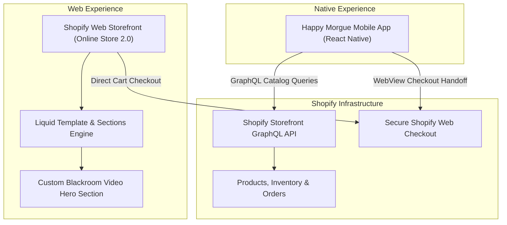

# Happy Morgue Shopify Storefront

> Custom Shopify Online Store 2.0 theme featuring the bespoke "Blackroom" hero section, gothic apparel aesthetics, and Storefront API endpoints.

[](https://shopify.dev/docs/themes)
[](https://shopify.github.io/liquid/)
[](https://github.com/Shopify/dawn)
[](https://github.com/jsalg-byte/happymorgue_mobile)
[](LICENSE)

`happymorgue_shopify` is the e-commerce storefront theme powering **Happy Morgue** apparel and artifacts. Built atop Shopify's performant Online Store 2.0 architecture (Dawn v15.4.0), it introduces custom dark-aesthetic layouts, ambient video background loops, and deep integration with the companion native mobile application.

---

## Ecosystem Architecture

This theme serves as both the primary web shopping portal and the catalog provider for the native mobile client:



---

## Key Features & Custom Engineering

- **Bespoke "Blackroom" Section (`sections/blackroom-home.liquid`)**:
  - Full-bleed ambient video background with fallback image loading.
  - Gothic aesthetic gradient overlays and high-contrast typography.
  - Direct deep-links to featured collections and apparel drops.
- **Online Store 2.0 Flexibility**:
  - Completely modular JSON template structure (`templates/*.json`).
  - Native support for theme app extensions, announcement bars, and collapsible FAQ drawers.
- **Optimized Mobile UX**:
  - Fast-loading lightweight CSS (`assets/blackroom-home.css`).
  - Accessible touch targets, quick-order variant pickers, and dynamic cart notifications.
- **API Companion**:
  - Exposes the GraphQL schema consumed by the native mobile application ([`happymorgue_mobile`](https://github.com/jsalg-byte/happymorgue_mobile)).

---

## Theme Structure

```text
├── assets/                 # Compiled stylesheets, scripts, and brand SVG vectors
│   ├── blackroom-home.css  # Styling for bespoke hero video section
│   └── global.js           # Theme JavaScript and custom element definitions
├── config/                 # Theme settings definitions (settings_schema.json)
├── layout/                 # Base page wrappers (theme.liquid, password.liquid)
├── locales/                # Internationalization strings (en.default.json, etc.)
├── sections/               # Reusable section modules
│   ├── blackroom-home.liquid # Custom Happy Morgue hero video banner
│   ├── featured-product.liquid
│   └── main-product.liquid # Product detail page with apparel variant picker
├── snippets/               # Reusable Liquid fragments (buy-buttons, cart-drawer)
└── templates/              # JSON-based template layouts (index.json, product.json)
```

---

## Local Development with Shopify CLI

### Prerequisites

- [Shopify CLI](https://shopify.dev/docs/themes/tools/cli) installed (`brew tap shopify/shopify && brew install shopify-cli`)
- Authorized Shopify store staff account

### 1. Authenticate with Store

```sh
shopify auth login --store your-store-subdomain.myshopify.com
```

### 2. Start Local Theme Development Server

```sh
# Serves local theme files against the live store sandbox with hot reloading
shopify theme dev --store your-store-subdomain.myshopify.com
```

### 3. Check Theme Code Quality

```sh
shopify theme check
```

### 4. Push or Publish Theme

```sh
# Push changes to an unpublished development theme
shopify theme push --unpublished

# Publish as active theme
shopify theme publish
```

---

## Related Repositories

- [**happymorgue_mobile**](https://github.com/jsalg-byte/happymorgue_mobile): React Native mobile client connecting fans to the store's products, streaming radio, and interactive features.

---

## Attribution & License

- Based upon Shopify's open-source [Dawn](https://github.com/Shopify/dawn) reference theme (v15.4.0).
- Custom sections, styles, and branding are licensed under the MIT License. See [LICENSE](LICENSE) for details.
